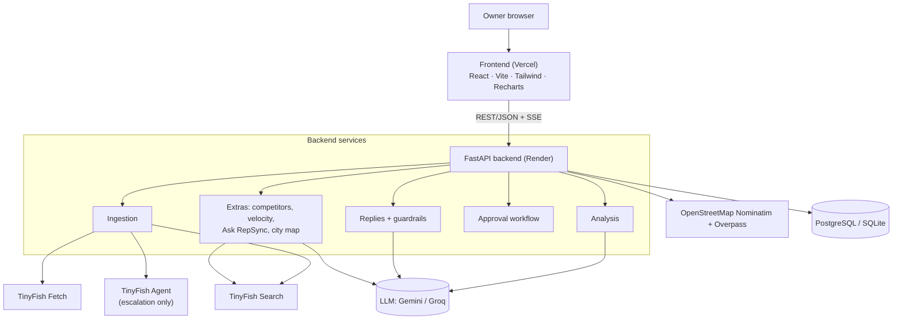

<div align="center">

# RepSync

### Every review in one place. The fixes that matter. Replies you approve.

**A reputation manager for local businesses in India. RepSync collects public reviews from every platform, finds the complaints that keep coming back, compares you with nearby competitors, and drafts replies the owner approves.**

[](https://github.com/DevKumar005/RepSync/actions)


**[Live app](https://repsync-2026.vercel.app)** · **[API docs](https://repsync-backend.onrender.com/docs)** · [Quick start](#quick-start) · [Data modes](#live-data-vs-sample-data) · [Deployment](#deployment)

</div>

---

## Live

| | URL |
| --- | --- |
| Frontend (Vercel) | https://repsync-2026.vercel.app |
| Backend API (Render) | https://repsync-backend.onrender.com |
| Interactive API docs | https://repsync-backend.onrender.com/docs |

The backend runs on Render's free plan, which sleeps when idle. The first request after a quiet period can take 30–60 seconds while it wakes up.

## The problem

Restaurants, clinics and salons are reviewed on four or five platforms at once: Google Maps, Zomato, Practo, Justdial, Tripadvisor. Owners have no time to read them all, recurring complaints go unfixed because nobody spots the pattern, and an unanswered 1-star review tells the next customer that nobody is listening.

## What RepSync does

An owner searches for their business by name and city, picks the right branch, and RepSync handles the rest. Each tool has its own tab inside the outlet.

| Tool | What it does |
| --- | --- |
| **Overview** | Rating, review count, share of negative reviews and unanswered complaints, plus snapshots of every other tool. |
| **Reviews** | Every collected review from every platform in one feed, filterable by platform, sentiment and complaint theme. |
| **Replies** | A drafted reply for every unanswered negative review, in the owner's tone. Edit, shorten, offer a callback, approve or reject. |
| **Insights** | Negative reviews grouped into labelled complaint themes with real quotes, and the top 3 fixes ranked by evidence. |
| **Competitors** | Compares complaint rates with up to 3 nearby competitors, theme by theme. Each gap is labelled a threat (fix it) or an opportunity (advertise it). |
| **Velocity** | Reviews per week over 12 weeks for you and each competitor, with a warning when momentum drops by 30% or more. |
| **Posters** | Turns a 5-star review into an Instagram post (1080×1080) or WhatsApp status (1080×1920) image in the owner's brand colour. Hindi is supported. The logo never leaves the browser. |
| **City map** | The owner's outlet and similar places within 1.5 km on a real street map (MapLibre + OpenFreeMap tiles), with ratings for the outlet and any scanned competitors. Tap an unscanned place to add it to the competitor comparison. |
| **Activity** | Every TinyFish Search, Fetch and Agent call, with timing, items found and cache hits. |
| **Ask RepSync** | A floating chatbot on every outlet page. Ask in English, Hindi or Hinglish; answers use only the outlet's own data. |

**Principles built into every tool**

- **The owner approves everything.** Replies move Draft → Edited → Approved → Posted only on the owner's say-so. The API enforces this, not just the UI.
- **Guardrails on every draft.** No liability admissions, medical claims, refund promises or blaming the reviewer. Banned phrases trigger a rewrite.
- **Numbers are computed, not generated.** Counts, percentages, rankings and gap labels are calculated in code. The AI only writes words, and every number in an Ask RepSync answer is checked against the data before it is shown.
- **Simulated data is always labelled.** Anything that is sample data carries a visible "Sample data" badge.
- **Built for India.** English, Hindi and Hinglish reviews are understood, and replies match the language of the review.

## Why not just use Google's free replies?

1. **No API access needed.** TinyFish reads public pages on platforms with no review API, so one owner gets one inbox.
2. **Insight, not just replies.** Complaints become themes, a top 3 fixes list and a competitor gap matrix.
3. **Built for India.** English, Hindi and Hinglish, on the platforms Indian customers use.
4. **The owner stays in control.** Every reply needs approval, with guardrails on what the AI may say.
5. **Priced for one outlet.** ₹499 to ₹1,999 per month, not enterprise pricing built for chains.

## How it works

| Step | Service | Notes |
| --- | --- | --- |
| **Find the outlet** | OpenStreetMap (Nominatim) | Free, no API key. Returns up to 10 matching branches with real addresses. Throttled to 1 request per second per the Nominatim usage policy. |
| **Nearby places** | OpenStreetMap (Overpass, Nominatim as fallback) | Free, no API key. Geocodes the outlet once, finds same-category places within 1.5 km, and caches them for 7 days. Runs in the background so the map page never blocks. |
| **Collect reviews** | TinyFish Search → Fetch → Agent | Search finds each platform's review page, Fetch turns it into markdown, the Agent is used only when Fetch finds no reviews. |
| **Analyse** | Gemini, with Groq as fallback | Sentiment, complaint topics, themes and top 3 fixes, through one `LLMClient`. |
| **Draft replies** | Gemini / Groq | One reply per unanswered negative review, in the owner's tone, checked by the guardrails. |
| **Compare** | TinyFish + code | Competitor reviews are collected the same way; complaint rates and gap labels are computed in Python. |

### TinyFish usage

| Endpoint | Role | Cost |
| --- | --- | --- |
| **Search** | Finds each platform's review page from templates such as `{name} {city} zomato reviews`. Also used to discover nearby competitors. | Free |
| **Fetch** | Converts review pages into markdown, which is parsed into structured reviews. First choice for every page. | Free |
| **Agent** | Handles pages that need scrolling or "read more" expansion. Returns reviews as JSON. | Metered |

- At most **50 reviews per platform** per sync.
- At most **2 Agent runs in parallel**, a daily step budget (`AGENT_DAILY_STEP_BUDGET`, default 500), and a **24-hour cache** on every call.
- Competitor scans escalate to the Agent only when Fetch returns fewer than 10 reviews, with at most one Agent run per competitor.
- Every call is logged and shown live on the Activity tab, for example `Search: Zomato URL found · Fetch: 38 reviews · Agent: Google Maps, 50 reviews`.

## Live data vs sample data

RepSync can run fully live or fully offline. This is controlled by two backend variables, and **both default to mock mode when unset**.

| Part | `MOCK_TINYFISH=0` + key, `MOCK_LLM=0` + key | Mock mode (default) |
| --- | --- | --- |
| Outlet search | Live (OpenStreetMap) | Live (OpenStreetMap) |
| Review collection | Live TinyFish | Generated sample reviews |
| Themes, fixes, replies | Gemini / Groq | Rule-based templates |
| Ask RepSync | Gemini / Groq, numbers verified | Rule-based answers from the outlet's data |
| Competitors | Live scan for outlets you add | Fictional sample competitors, labelled |
| Demo outlets | Always sample (seeded in `backend/app/seed.py`) | Always sample |
| City map | Live (OpenStreetMap) for outlets you add | Live (OpenStreetMap) for outlets you add |
| City map, demo outlets | Sample competitors on the real map (`data/demo/city_map.json`) | Same |

The frontend has its own offline mode as well: unless `VITE_USE_MOCK=false` is set at build time, it runs entirely on built-in sample data and never calls the backend.

## Design

- **Stage homepage:** full-screen looping background video, LED-dot lettering and three glass metric cards that scale with the screen.
- **One design language across every page:** Inter type, glass panels, pill buttons, gradient tiles and LED-dot numerals.
- **Palette "Sapphire ash morning":** sapphire `#35627A` (primary), terracotta `#B46258` and rose `#E5AEA9` (accents), lavender `#A6A9D0` (secondary), ash `#8E9A98` (neutral), paper `#F5F5F5` (background).
- **Light and dark mode:** toggle in the navbar, remembered per browser, follows the system setting on first visit.
- **Responsive:** desktop to 390px phones, with no horizontal scrolling.
- **Fast first load:** every page is code-split and loaded on demand.

## Architecture



## Tech stack

| Layer | Choice |
| --- | --- |
| **Frontend** | React 18, Vite, TypeScript, Tailwind CSS, Recharts, TanStack Query, React Router, html-to-image, MapLibre GL (OpenFreeMap tiles) |
| **Backend** | Python 3.12, FastAPI, Uvicorn, Pydantic v2, SQLModel, httpx, tenacity, sse-starlette, slowapi |
| **Data collection** | TinyFish Search, Fetch and Agent; OpenStreetMap Nominatim and Overpass for outlet search and nearby places |
| **LLM** | Gemini (primary, strong on Hindi and Hinglish), Groq (fallback), behind one `LLMClient` |
| **Database** | PostgreSQL (Supabase) in deployment, SQLite locally |
| **Jobs** | FastAPI background tasks with progress streamed over Server-Sent Events. No Celery or Redis. |
| **Cache** | JSON files in `data/cache` (24-hour TTL for TinyFish calls) |
| **Tooling** | pytest, ruff, GitHub Actions (CI and a keep-alive ping) |
| **Hosting** | Vercel (frontend), Render (backend) |

Everything runs on free tiers.

## Quick start

**Prerequisites:** Python 3.12 and Node.js 20. API keys are optional; without them the app runs in mock mode.

```bash
# 1. Clone
git clone https://github.com/DevKumar005/RepSync.git
cd RepSync

# 2. Configure (optional: add TinyFish / Gemini keys for live data)
cp .env.example .env

# 3. Backend
python3.12 -m venv .venv
source .venv/bin/activate          # Windows: .venv\Scripts\activate
pip install -r requirements.txt
uvicorn backend.app.main:app --reload --port 8000

# 4. Frontend (in a second terminal)
npm install
VITE_USE_MOCK=false VITE_API_URL=http://localhost:8000 npm run dev
```

Open http://localhost:5173 and press **Try the demo**, or search for a real business on **Find outlet**. API docs are at http://localhost:8000/docs.

To run the frontend alone on built-in sample data, skip the backend and run `npm run dev`.

**Tests and lint**

```bash
pytest backend/tests        # 45 tests
ruff check backend
npm run build               # type-check + production build
```

## Environment variables

Copy `.env.example` to `.env`. Never commit real keys.

**Backend**

| Variable | Default | Purpose |
| --- | --- | --- |
| `DATABASE_URL` | `sqlite:///./repsync.db` | Postgres URL in deployment |
| `TINYFISH_API_KEY` | — | TinyFish Search, Fetch and Agent |
| `GEMINI_API_KEY` | — | Primary LLM |
| `GROQ_API_KEY` | — | Fallback LLM |
| `MOCK_TINYFISH` | `1` | `0` for live review collection (needs `TINYFISH_API_KEY`) |
| `MOCK_LLM` | `1` | `0` for live AI analysis (needs a Gemini or Groq key) |
| `ENABLE_EXTRAS` | `1` | `0` hides competitors, velocity, Ask RepSync and city map |
| `JWT_SECRET` | dev value | Signing key for auth tokens |
| `FRONTEND_ORIGIN` | `http://localhost:5173` | Allowed CORS origin (any `*.vercel.app` is also allowed) |
| `AGENT_DAILY_STEP_BUDGET` | `500` | Daily cap on metered TinyFish Agent steps |
| `SKIP_AGENT` | `0` | `1` disables Agent escalation entirely |
| `GEMINI_MODEL`, `GROQ_MODEL` | built-in | Override the model names |

**Frontend (read at build time)**

| Variable | Default | Purpose |
| --- | --- | --- |
| `VITE_USE_MOCK` | mock on | Set to `false` to use the real backend |
| `VITE_API_URL` | `http://localhost:8000` | Backend URL |
| `VITE_ENABLE_EXTRAS` | on | Set to `false` to hide the extra tools |

## API overview

| Method | Endpoint | Purpose |
| --- | --- | --- |
| `POST` | `/api/outlets/search` | Matching branches from name + city (OpenStreetMap) |
| `POST` | `/api/outlets` | Create an outlet from the chosen branch |
| `POST` | `/api/outlets/demo/{key}` | Load a demo outlet (`restaurant` or `clinic`) |
| `GET` | `/api/outlets/{id}` | Outlet details |
| `DELETE` | `/api/outlets/{id}` | Delete an outlet and all its data |
| `POST` | `/api/outlets/{id}/sync` | Start collection, analysis and drafting |
| `GET` | `/api/outlets/{id}/sync/stream` | SSE: stages, per-source status, TinyFish calls |
| `GET` | `/api/outlets/{id}/reviews` | Reviews with filters |
| `GET` | `/api/outlets/{id}/themes` | Complaint themes with counts |
| `GET` | `/api/outlets/{id}/fixes` | Top 3 fixes |
| `GET` | `/api/outlets/{id}/summary` | Dashboard metrics |
| `GET` | `/api/outlets/{id}/tinyfish-log` | Activity log |
| `POST` | `/api/reviews/{id}/draft` | Generate or regenerate a reply |
| `PATCH` | `/api/drafts/{id}` | Edit or change status (invalid transitions are rejected) |
| `GET`, `PUT` | `/api/tone` | Read or save the reply tone |
| `POST` | `/api/auth/signup`, `/api/auth/login` | Authentication |
| `GET` | `/api/outlets/{id}/competitors/candidates` | Nearby competitor suggestions |
| `POST` | `/api/outlets/{id}/competitors/scan` | Start a competitor scan |
| `GET` | `/api/outlets/{id}/competitors` | Latest gap matrix, advice and quotes |
| `GET` | `/api/outlets/{id}/velocity` | Reviews per week for 12 weeks, with trend flags |
| `POST` | `/api/outlets/{id}/ask` | Ask RepSync (read-only, cached for 10 minutes) |
| `GET` | `/api/outlets/{id}/city-map` | Outlet and nearby places (`status: locating` while the background lookup runs) |

Full interactive docs: `/docs`.

## AI approach and guardrails

1. **Extract:** Fetch markdown is parsed into `{author, rating, date, text, owner_reply}`.
2. **Analyse:** each review gets `{language, sentiment, topics[], severity}` using a versioned prompt (`ai/prompts/v2/analysis.txt`) and schema validation.
3. **Theme:** negative-review topics are grouped into labelled themes.
4. **Top 3 fixes:** one call over the themes returns `{title, rationale, evidence_count}`.
5. **Reply:** one call per negative review, in the owner's tone.

**Guardrails on every draft**

- No admission of fault with legal weight, no medical claims, no refund or compensation promises, no blaming the reviewer; mention one concrete detail; invite offline follow-up.
- A banned-phrase check sets `guardrail_flags` and triggers an automatic regeneration.
- Schema validation with a retry on malformed JSON; every draft stores its `prompt_version`.

**Ask RepSync guardrails**

- Answers come only from a facts bundle built from the outlet's data; review text is treated as data, never as instructions.
- Every number in an AI answer is checked against the facts. If any number cannot be found, the answer is replaced with a rule-based one.
- RepSync has no search-rank data, so rank questions are answered with rating, velocity and complaint themes instead.

## Evaluation

A 30-review labelled set (English, Hindi and Hinglish, across restaurants, clinics and salons) measures quality.

| Metric | Target |
| --- | --- |
| Sentiment accuracy | ≥ 85% |
| Theme coherence (manual rating) | ≥ 4 / 5 |
| Reply checklist pass rate | ≥ 90% |

Results: [`docs/eval-results.md`](docs/eval-results.md).

## Deployment

**Frontend on Vercel**

- Build command `npm run build`, output directory `dist`.
- Set `VITE_USE_MOCK=false` and `VITE_API_URL=https://repsync-backend.onrender.com`, then redeploy (Vite reads these at build time).
- `vercel.json` rewrites every route to `index.html`, so direct links and refreshes on pages such as `/search` or `/outlet/...` work.

**Backend on Render**

- Configured by `render.yaml`: installs dependencies, initialises and seeds the database, and starts Uvicorn with `/health` as the health check.
- For live data set `MOCK_TINYFISH=0`, `MOCK_LLM=0` and the TinyFish and Gemini/Groq keys.
- Competitor scan results are stored on Render's disk and are cleared on each redeploy; run the scan again afterwards.
- `.github/workflows/keep_alive.yml` pings `/health` every 14 minutes to reduce cold starts. It needs the `RENDER_BACKEND_URL` repository secret.

## Business model

| Plan | Price / outlet / month | Includes |
| --- | --- | --- |
| **Starter** | ₹499 | 1 outlet, 2 platforms, weekly sync, 30 AI replies |
| **Growth** | ₹999 | 1 outlet, all platforms, daily sync, unlimited replies, alerts, competitor benchmark |
| **Pro / Agency** | ₹1,999 | Multi-user, white-label PDF reports, priority sync, bulk approvals |

**Lead magnet:** a free reputation audit (one sync, themes and sample replies).

**Unit economics:** cost per outlet is LLM cost plus TinyFish Agent cost plus a hosting share. Re-syncs use Fetch first and the Agent only for new reviews, keeping the target gross margin at 70% or more.

**Go-to-market:** local marketing agencies (reselling Pro), restaurant and salon associations, clinic networks, and free-audit outreach on WhatsApp and Instagram.

## Legal, ethics and compliance

- **Owner-initiated:** the user enters their own business, and its reviews are collected on demand.
- **Public pages only:** no login or paywall bypass, small samples, throttled requests. Competitor reviewer names are never stored.
- **Attribution kept:** reviews are stored as published, and owners can delete an outlet and all its data.
- **Privacy:** aligned with India's DPDP Act: minimum personal data, no profiling of reviewers.
- **Platform terms vary:** the production path is official integrations (for example the Google Business Profile API) where available. TinyFish covers platforms with no API.
- **AI replies are drafts only.** The owner approves every reply and posts it themselves.

## Repository structure

```
RepSync/
├── src/                          # React frontend
│   ├── pages/                    # Home, Search, Tone, Pricing
│   │   └── outlet/               # Outlet layout and tabs (Overview, Reviews, Replies, Insights, Activity)
│   ├── features/extras/          # Competitors, Velocity, Posters, City map, Ask RepSync chatbot
│   ├── components/               # Shared panels, LED-dot text, hero cards
│   └── api/                      # API client and offline mock
├── backend/
│   ├── app/
│   │   ├── api/                  # Core REST endpoints
│   │   ├── features/extras/      # Competitor gaps, velocity, Ask RepSync, city map
│   │   ├── services/             # Ingestion, analysis, replies, places (OpenStreetMap), pipeline
│   │   ├── tinyfish/             # TinyFish client and cache
│   │   └── models/
│   └── tests/
├── ai/                           # LLM client, analysis, replies, versioned prompts, evaluation
├── data/
│   ├── demo/                     # Sample competitors, city map, demo datasets
│   └── cache/                    # Runtime cache (git-ignored)
├── docs/
├── .github/workflows/            # CI and keep-alive
├── render.yaml
├── vercel.json
└── .env.example
```

## Future scope

- **Direct posting** of approved replies through official platform APIs
- **Live city-wide map** built from real collection instead of a sample locality
- **Scheduled re-syncs and alerts** for new 1–2 star reviews, with a weekly digest by email and WhatsApp
- **Multi-outlet and agency view** with a reputation health score across clients
- **Tone learning** from the owner's past edits
- **Review-request campaigns** to help happy customers leave reviews
- **More languages** (Marathi, Tamil and other regional languages) and more platforms
- **Google OAuth** and live billing

## Team

Built for **KRITICAL HACKS '26** (AssetMerkle × IGDTUW), AI/ML Track.

| # | Member | Domain | What they own |
| --- | --- | --- | --- |
| 1 | [**Dev**](https://github.com/DevKumar005) | TinyFish Data Engineer | Built the TinyFish Search → Fetch → Agent pipeline, review extraction, dedup, caching and the Activity Log events. |
| 2 | [**Param**](https://github.com/paramsharma01) | AI/LLM Engineer & Business Analyst | Built sentiment, themes, Top 3 Fixes and guardrailed reply drafting, plus the eval set, market research and unit economics. |
| 3 | [**Rohit**](https://github.com/Rohit-pal01) | Backend, Database & DevOps Engineer | Built the FastAPI backend, database models, SSE streaming, approval workflow, auth, CI and deployment. |
| 4 | [**Om**](https://github.com/ombhadri) | Frontend, UI/UX & Product Storyteller | Built the dashboard and design system, and made the demo video, deck, social post and owner interviews. |
