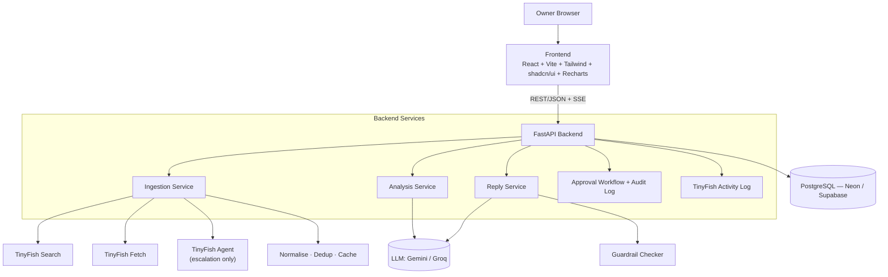

<div align="center">

# 🔄 RepSync

### One inbox for every review. One tap to reply. One list of what to fix.

**A local business reputation manager that pulls public reviews from across platforms, finds the recurring complaints, and drafts replies the owner approves.**

[](https://github.com/DevKumar005/RepSync/actions)


[Demo Mode](#-demo-mode) · [How TinyFish Is Used](#-how-tinyfish-is-used) · [Quick Start](#-quick-start) · [Future Scope](#-future-scope)

</div>

---

## 📸 Preview

https://repsync-chi.vercel.app

---

## 🚨 The Problem

Small businesses (restaurants, clinics, salons) lose customers to bad reviews they never see or never answer. Reviews are scattered across **Google Maps, Zomato, Practo, JustDial** and more. Owners have no time to check four dashboards, and an unanswered negative review tells the next customer that nobody cares.

## ✨ What RepSync Does

An owner types their **business name and city**, confirms the outlet, and RepSync does the rest.

| Capability | Description |
| --- | --- |
| 🔎 **Unified review collection** | Finds the outlet's review pages on at least 2 platforms and extracts reviews into one normalised feed (author, rating, date, text, URL, owner reply). |
| 🧠 **Sentiment and themes** | Classifies every review and clusters negative ones into labelled themes (for example "slow service") with counts, percentages and representative quotes. |
| 🛠️ **Top 3 Fixes** | Turns themes into the three most valuable things to fix, with evidence counts. The point is fixing the business, not only replying. |
| ✍️ **Tone-aware reply drafts** | Drafts a reply for each negative review that references specifics from that review, in the owner's tone (warm, formal, apologetic, concise). |
| 🛡️ **Guardrails** | No liability admissions, no medical claims, no refund promises, no blaming the reviewer. Banned phrases trigger an automatic regeneration. |
| ✅ **Approval workflow** | Draft → Edited → Approved → Rejected → Posted. Nothing is ready to post without explicit owner approval, enforced in the API and not just the UI. |
| 📊 **Dashboard** | Summary cards, theme chart, filterable review feed, reply queue, Top 3 Fixes, and the TinyFish Activity Log. |
| 🇮🇳 **Built for India** | Understands English, Hindi and Hinglish reviews, and replies in the language of the review. |

## 💡 Why Not Just Use Google's Free Replies?

Tools like Birdeye, Podium and ReviewTrackers exist, and owners can already reply for free inside Google. RepSync is different in five ways:

1. **No API access needed.** TinyFish reads public pages on platforms that offer no review API, so one owner gets one unified inbox.
2. **Insight, not just replies.** Complaints become themes with counts and a "Top 3 Fixes" list.
3. **Built for India.** English, Hindi and Hinglish are understood, and replies match the owner's language and tone.
4. **The owner stays in control.** Every reply needs explicit approval, with guardrails on what the AI may say.
5. **Priced for small outlets.** ₹499 to ₹1,999 per month, instead of enterprise pricing built for chains.

## 🐟 How TinyFish Is Used

TinyFish is the data backbone of RepSync. Every call is recorded and shown live in the UI.

| Endpoint | Role in RepSync | Cost |
| --- | --- | --- |
| **Search** | Outlet lookup from name and city, and finding each platform's review page URL through query templates such as `{name} {city} reviews`, `{name} {city} zomato`, `{name} {city} practo`. | Free |
| **Fetch** | Converts review pages into clean markdown, which an LLM turns into structured reviews. **First choice for every page.** | Free |
| **Agent** | Handles pages that need scrolling, "load more" or "read more" expansion, or sort-by-newest. Returns reviews as JSON. | Metered |

**Collection strategy**

```
Search → Fetch → count parsed reviews
        └─ fewer than 10 reviews, truncated text, or JS-only page?
              └─ escalate to Agent → normalise → dedup → store
```

- Capped at **50 reviews per platform** in demo runs, with platforms running in parallel.
- Agent runs are **capped** (a small number of runs per platform per sync, limited steps and time), **cached for 24 hours**, and used sparingly, since the Agent is metered.
- Re-syncs are **incremental**: Fetch first, and Agent only for new reviews.
- **TinyFish Activity Log:** a live panel in the UI showing every Search, Fetch and Agent call, for example:
  `Search: found 6 candidate pages · Fetch: Zomato OK, 38 reviews · Agent: Google Maps scrolling, 50 reviews`

## 🏗️ Architecture



## 🧰 Tech Stack

| Layer | Choice |
| --- | --- |
| **Frontend** | React 18, Vite, TypeScript, Tailwind CSS, shadcn/ui, Recharts, TanStack Query, React Router |
| **Backend** | Python 3.12, FastAPI, Uvicorn, Pydantic v2, SQLModel, httpx, tenacity, sse-starlette |
| **Data collection** | TinyFish Search, Fetch and Agent |
| **LLM** | Primary: Gemini (free tier, strong Hindi/Hinglish). Fallback: Groq (Llama). Both sit behind one `LLMClient` interface. |
| **Database** | PostgreSQL (Neon or Supabase free tier) in deployment, SQLite for local dev |
| **Jobs** | `asyncio` tasks and FastAPI `BackgroundTasks`, with progress streamed over SSE. No Celery or Redis. |
| **Cache** | DB table keyed by hash of (endpoint, input), plus JSON files in `data/cache` |
| **Auth** | Seeded demo user for the prototype, then email + bcrypt + JWT |
| **Tooling** | uv, Node 20 LTS, ruff, prettier, pytest, GitHub Actions |
| **Hosting** | Vercel (frontend), Render free web service with keep-alive ping (backend) |

> Everything runs on free tiers. No Web3 is used anywhere in the project.

## 🚀 Quick Start

**Prerequisites:** Python 3.12, [uv](https://docs.astral.sh/uv/), Node.js 20 LTS, `make`, and API keys for TinyFish and Gemini (Groq optional).

```bash
# 1. Clone
git clone https://github.com/DevKumar005/RepSync.git
cd RepSync

# 2. Configure environment
cp .env.example .env        # then fill in your keys (see below)

# 3. Install backend + frontend dependencies
make setup

# 4. Run backend and frontend together
make dev

# 5. Open the app
# Frontend → http://localhost:5173
# API docs → http://localhost:8000/docs
```

Run the tests:

```bash
cd backend && uv run pytest
```

> If a `make` target differs in your checkout, check the `Makefile` for the exact commands.

## 🔐 Environment Variables

Copy `.env.example` to `.env`. **Never commit real keys.**

| Variable | Purpose |
| --- | --- |
| `TINYFISH_API_KEY` | TinyFish Search / Fetch / Agent (sent as the `X-API-Key` header) |
| `GEMINI_API_KEY` | Primary LLM (Google AI Studio free tier) |
| `GROQ_API_KEY` | Fallback LLM (optional) |
| `DATABASE_URL` | Postgres URL in deployment. Defaults to local SQLite in dev. |
| `JWT_SECRET` | Signing key for auth tokens |
| `DEMO_MODE` | `true` to serve cached demo data with all external APIs disabled |

> The variable names above are the intended ones. Match them to your `.env.example` if they differ.

## 🔌 API Overview

| Method | Endpoint | Purpose |
| --- | --- | --- |
| `POST` | `/api/outlets/search` | Candidate outlets from name + city (TinyFish Search) |
| `POST` | `/api/outlets` | Confirm and create an outlet |
| `POST` | `/api/outlets/demo/{key}` | Load a cached demo outlet |
| `POST` | `/api/outlets/{id}/sync` | Start collection + analysis + drafting job |
| `GET` | `/api/outlets/{id}/sync/stream` | **SSE**: progress, per-source status, TinyFish call events |
| `GET` | `/api/outlets/{id}/reviews` | Reviews with filters (platform, rating, sentiment, theme) |
| `GET` | `/api/outlets/{id}/themes` | Themes with counts and quotes |
| `GET` | `/api/outlets/{id}/fixes` | Top 3 fixes |
| `GET` | `/api/outlets/{id}/summary` | Dashboard metrics |
| `GET` | `/api/outlets/{id}/tinyfish-log` | Activity Log entries |
| `POST` | `/api/reviews/{id}/draft` | Generate or regenerate a reply (optional instruction) |
| `PATCH` | `/api/drafts/{id}` | Edit text or change status (server rejects invalid transitions) |
| `PUT` | `/api/tone` | Save tone profile |
| `POST` | `/api/auth/signup`, `/api/auth/login` | Authentication |
| `DELETE` | `/api/outlets/{id}` | Delete outlet and all its data |

**SSE event shape**

```json
{ "type": "source_status | tinyfish_call | stage | done", "source": "zomato", "status": "ok", "message": "…", "ts": "…" }
```

Full interactive docs are available at `/docs` (OpenAPI).

## 🤖 AI Approach and Guardrails

**Pipeline**

1. Clean text, detect language (English / Hindi / Hinglish), dedup.
2. **Extract:** LLM converts Fetch markdown into `[{author, rating, date, text, owner_reply}]`.
3. **Analyse:** batches of 20–30 reviews return schema-validated JSON `{review_id, language, sentiment, topics[], severity 1-3}`.
4. **Theme:** one LLM call groups negative-review topics into 3–7 labelled themes. No embeddings are needed.
5. **Top 3 fixes:** one call over the themes returns `{title, rationale, evidence_count}`.
6. **Reply:** one call per negative review, using the owner's tone profile.

**Guardrails on every draft**

- Prompt rules: no admission of fault with legal weight, no medical claims or advice, no refund or compensation promises, no blaming the reviewer, mention one concrete detail from the review, invite offline follow-up, 60–80 words.
- A **banned-phrase check** (for example "our fault", "we admit", "guarantee", "refund", "cure", "diagnos", "compensat", "legal") sets `guardrail_flags` and triggers one automatic regeneration.
- Pydantic schema validation with one retry on malformed JSON.
- Every draft stores its `prompt_version`, and prompts are versioned in `prompts/`.

## 🧪 Evaluation

A **30-review labelled evaluation set** (English, Hindi, Hinglish, across restaurants, clinics and salons) is used to measure quality. Targets:

| Metric | Target |
| --- | --- |
| Sentiment accuracy | ≥ 85% |
| Theme coherence (manual rating) | ≥ 4 / 5 |
| Reply checklist pass rate (specific, on-tone, no banned phrase) | ≥ 90% |

Results are published in [`docs/eval-results.md`](docs/eval-results.md).

## 💰 Business Model

| Plan | Price / outlet / month | Includes |
| --- | --- | --- |
| **Starter** | ₹499 | 1 outlet, 2 platforms, weekly sync, 30 AI replies |
| **Growth** | ₹999 | 1 outlet, all platforms, daily sync, unlimited replies, alerts, competitor benchmark |
| **Pro / Agency** | ₹1,999 | Multi-user, white-label PDF reports, priority sync, bulk approvals |

**Lead magnet:** a free reputation audit (one sync, themes and 5 sample replies).

**Unit economics:** cost per outlet = LLM cost + TinyFish Agent cost + hosting share. Re-syncs are incremental (Fetch first, Agent only for new reviews) so the Growth plan keeps a healthy margin. The target gross margin is ≥ 70%, to be measured from real usage logs.

**Go-to-market:** local marketing agencies (resell Pro), restaurant and salon associations, clinic networks, and free-audit outreach on WhatsApp and Instagram.

## ⚖️ Legal, Ethics and Compliance

- **Owner-initiated:** the user enters their *own* business, so reviews about it are collected on demand.
- **Public pages only:** no login or paywall bypass, small samples, throttled requests.
- **Attribution kept:** reviews are stored as published, and owners can **delete an outlet and all its data**.
- **Privacy:** aligned with India's DPDP Act: minimum personal data, no profiling of reviewers.
- **Platform terms vary:** the production path is **official integrations** (for example the Google Business Profile API for owners' own listings) where available. TinyFish covers platforms with no API and powers the free audit.
- **AI replies are drafts only.** The owner approves every reply and posts it themselves.

## 📁 Repository Structure

```
RepSync/
├── backend/
│   ├── app/
│   │   ├── api/
│   │   ├── services/{ingestion,analysis,replies}/
│   │   ├── models/
│   │   ├── llm/
│   │   └── tinyfish/
│   └── tests/
├── frontend/
│   └── src/{pages,components,api,hooks}/
├── data/{demo,cache,eval}/
├── docs/
│   ├── architecture.png
│   ├── tinyfish-usage.md
│   ├── ai-approach.md
│   └── eval-results.md
├── .github/workflows/ci.yml
├── Makefile
├── README.md
└── .env.example
```

## 🔭 Future Scope

- **Direct posting** of approved replies through official platform APIs (for example the Google Business Profile API)
- **Live competitor benchmark** against nearby outlets, reusing the same collection pipeline
- **Scheduled re-syncs and alerts** for new 1–2 star reviews, plus a weekly digest by email and WhatsApp
- **Multi-outlet and agency view** with a reputation health score and pending replies across clients
- **Tone learning** from the owner's past edits, so drafts need fewer changes over time
- **Review-request campaigns** to help happy customers leave reviews
- **More languages**, including Marathi, Tamil and other regional languages
- **More platforms** beyond Google Maps, Zomato, Practo and JustDial
- **Review-to-operations integrations** that flag recurring issues straight to staff
- **Google OAuth** and live billing

## 👥 Team

Built for **KRITICAL HACKS '26** (AssetMerkle × IGDTUW), AI/ML Track.

| # | Member | Domain | What they own |
| --- | --- | --- | --- |
| 1 | [**Dev**](https://github.com/DevKumar005) | TinyFish Data Engineer | Built the TinyFish Search → Fetch → Agent pipeline, review extraction, dedup, caching and the Activity Log events. |
| 2 | [**Param**](https://github.com/paramsharma01) | AI/LLM Engineer & Business Analyst | Built sentiment, themes, Top 3 Fixes and guardrailed reply drafting, plus the eval set, market research and unit economics. |
| 3 | [**Rohit**](https://github.com/Rohit-pal01) | Backend, Database & DevOps Engineer | Built the FastAPI backend, database models, SSE streaming, approval workflow, auth, CI and deployment. |
| 4 | [**Om**](https://github.com/ombhadri) | Frontend, UI/UX & Product Storyteller | Built the dashboard and design system, and made the demo video, deck, social post and owner interviews. |

## 📄 License

Add a license (for example MIT) by creating a `LICENSE` file, then update this section.

---
