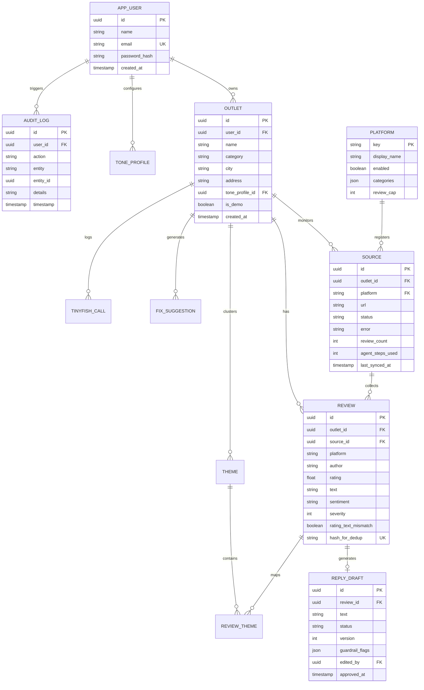

# RepSync Database Specification & Schema

This document details the database architecture, schema definitions, and connection configuration for **RepSync** (M3 Role).

---

## 1. Entity-Relationship (ER) Diagram

---

## 2. Table Catalog

| Table | Purpose | Primary SRS Ref |
|---|---|---|
| `app_user` | Business owner accounts, authentication | FR-7 |
| `tone_profile` | Business brand tone style, custom reply samples, forbidden phrases (`do_not_say`) | FR-5.3 |
| `outlet` | Business location (Restaurant, Clinic, Salon) | FR-1 |
| `platform` | Supported review platform registry (`google_maps`, `zomato`, `justdial`, `practo`, `tripadvisor`) | Section 2.1 |
| `source` | Tracking review collection per platform per outlet (status, steps, sync time) | M3-MP-2 |
| `review` | Normalized reviews with deduplication hash (`hash_for_dedup`), sentiment, severity | FR-2.5 |
| `theme` | AI-extracted positive and negative topic clusters | FR-3 |
| `review_theme` | Many-to-many relationship mapping reviews to themes | FR-3 |
| `fix_suggestion` | Ranked operational recommendations with evidence review count | FR-4 |
| `reply_draft` | Generated response drafts with approval state tracking (`draft`, `edited`, `approved`, `rejected`, `posted`) | FR-5 |
| `audit_log` | Server-side audit log for all draft approvals, status changes, and text edits | FR-5 |
| `tinyfish_call` | Activity log recording search, fetch, and agent calls with duration and steps used | FR-2.6 |
| `cache_entry` | Cached payload for TinyFish Agent runs (24h TTL) | M3-PIPE-6 |

---

## 3. Supabase Configuration & Pooling

1. **Direct Postgres Connection**:
   - For Render and hosted deployments, use the Supabase **Transaction Pooler** string (Port `6543`) with `sslmode=require`.
   - Pool configuration: `pool_size=5`, `max_overflow=10`, `pool_recycle=300`.
2. **Keep-Alive Touch**:
   - Supabase free-tier projects pause after a period of inactivity.
   - The keep-alive workflow ([`.github/workflows/keep_alive.yml`](file:///e:/repsync%20project/.github/workflows/keep_alive.yml)) pings `/health/db` daily to keep the database active.
3. **Row Level Security (RLS)**:
   - For the prototype, RLS is disabled at the database level because FastAPI acts as the single trusted backend connecting via service role credentials.
   - Endpoint authorization is strictly enforced in the API layer ([`backend/app/api/endpoints.py`](file:///e:/repsync%20project/backend/app/api/endpoints.py)).
